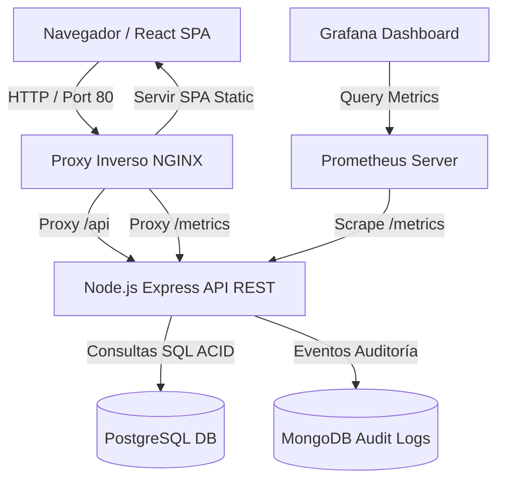

# 🛒 TechStore - Plataforma E-Commerce Académica de Alta Disponibilidad

[](https.github.com/techstore/techstore/actions)


---

## 📋 Table of Contents
- [1. Descripción del Proyecto](#1-descripción-del-proyecto)
- [2. Problema y Solución](#2-problema-y-solución)
- [3. Objetivos](#3-objetivos)
- [4. Tecnologías e Infraestructura](#4-tecnologías-e-infraestructura)
- [5. Arquitectura del Sistema](#5-arquitectura-del-sistema)
- [6. Estructura del Proyecto](#6-estructura-del-proyecto)
- [7. Instalación y Ejecución Local](#7-instalación-y-ejecución-local)
- [8. Despliegue con Docker Compose](#8-despliegue-con-docker-compose)
- [9. Documentación de la API REST](#9-documentación-de-la-api-rest)
- [10. Pruebas Automatizadas (Postman & Newman)](#10-pruebas-automatizadas-postman--newman)
- [11. CI/CD (GitHub Actions)](#11-cicd-github-actions)
- [12. Monitoreo y Observabilidad (Prometheus & Grafana)](#12-monitoreo-y-observabilidad-prometheus--grafana)
- [13. Orquestación Local con Kubernetes](#13-orquestación-local-con-kubernetes)
- [14. Despliegue en la Nube (Vercel & Render)](#14-despliegue-en-la-nube-vercel--render)
- [15. Seguridad, Accesibilidad y Buenas Prácticas](#15-seguridad-accesibilidad-y-buenas-prácticas)
- [16. Metodología Ágil y Organización del Equipo](#16-metodología-ágil-y-organización-del-equipo)
- [17. Conclusiones y Próximos Pasos](#17-conclusiones-y-próximos-pasos)

---

## 1. Descripción del Proyecto

**TechStore** es una plataforma de comercio electrónico de tecnología moderna desarrollada como proyecto académico integral. Permite a los usuarios navegar por un catálogo diversificado de productos tecnológicos (laptops, monitores, teclados, mouse, auriculares, impresoras y accesorios), buscar ítems, filtrar por categoría, inspeccionar especificaciones detalladas, gestionar un carrito interactivo y completar transacciones con validación estricta de stock y auditoría en tiempo real.

---

## 2. Problema y Solución

### El Problema
Muchas tiendas electrónicas carecen de validación de consistencia en el backend, permitiendo sobreventas sin stock real, auditorías frágiles y falta de observabilidad de métricas del servidor en tiempo real.

### La Solución
TechStore implementa una arquitectura híbrida de persistencia:
- **PostgreSQL**: Actúa como fuente de verdad operacional relacional (ACID) para productos, pedidos y detalles de transacciones.
- **MongoDB**: Almacena eventos de auditoría y comportamiento de usuarios (`PRODUCT_VIEWED`, `ORDER_CREATED`, `ORDER_FAILED`).
- **Prometheus + Grafana**: Proporciona telemetría operacional sobre throughput HTTP, latencia y errores.
- **Frontend React/Vite SPA**: Entrega una interfaz rápida, accesible y responsive.

---

## 3. Objetivos

1. Proveer una aplicación web 100% funcional y responsive.
2. Garantizar la consistencia transaccional del backend al recalcular precios y validar stock en servidor.
3. Demostrar la integración de múltiples motores de persistencia (PostgreSQL + MongoDB).
4. Automatizar la verificación mediante suites de Postman/Newman y flujos CI/CD en GitHub Actions.
5. Suministrar una infraestructura contenedorizada lista para Docker Compose y Kubernetes.

---

## 4. Tecnologías e Infraestructura

### Frontend
- **Framework**: React 18 + Vite 6
- **Lenguaje**: TypeScript
- **Estilos**: Tailwind CSS v3 (Aesthetic Dark Mode)
- **Iconografía**: Lucide React

### Backend
- **Runtime**: Node.js v20 / v24
- **Framework Web**: Express v4
- **Lenguaje**: TypeScript
- **Persistencia Relacional**: PostgreSQL (Cliente `pg`)
- **Persistencia NoSQL / Audit**: MongoDB (ODM `mongoose`)
- **Métricas**: `prom-client`
- **Seguridad**: `helmet`, `cors`

### DevOps, Monitoreo y Orquestación
- **Contenedores**: Docker & Docker Compose
- **Proxy Inverso**: NGINX
- **Observabilidad**: Prometheus & Grafana
- **Orquestación**: Kubernetes (Manifests compatibles con Minikube / k3s)
- **CI/CD**: GitHub Actions
- **Testing API**: Postman + Newman CLI

---

## 5. Arquitectura del Sistema



---

## 6. Estructura del Proyecto

```
TECHSTORE/
├── .github/
│   └── workflows/
│       └── ci.yml               # Pipeline de Integración Continua (GitHub Actions)
├── backend/
│   ├── src/
│   │   ├── config/              # Variables de entorno y configuración
│   │   ├── controllers/         # Lógica de controladores HTTP (Products, Orders, Health, Metrics)
│   │   ├── db/                  # Conexiones PostgreSQL, MongoDB y fallback resiliente
│   │   ├── middleware/          # Helmet, CORS, Error Handler, Prometheus Middleware
│   │   ├── routes/              # Enrutador API REST (/api)
│   │   ├── types/               # Definiciones de tipos TypeScript
│   │   └── index.ts             # Punto de entrada de la aplicación Express
│   ├── Dockerfile               # Build multi-stage para backend Node.js
│   ├── package.json
│   └── tsconfig.json
├── database/
│   └── init.sql                 # Esquema e inserción inicial de 16 productos
├── frontend/
│   ├── src/
│   │   ├── components/          # Navbar, Footer, ProductCard, LoadingSpinner, ErrorMessage
│   │   ├── context/             # CartContext con persistencia en localStorage
│   │   ├── pages/               # Home, Products, ProductDetail, Cart, Checkout, OrderConfirmation, Dashboard
│   │   ├── services/            # Cliente HTTP api.ts
│   │   ├── types.ts             # Interfaces frontend
│   │   ├── App.tsx
│   │   └── main.tsx
│   ├── Dockerfile               # Build multi-stage NGINX para frontend SPA
│   ├── index.html               # HTML semántico con meta tags SEO
│   ├── package.json
│   ├── tailwind.config.js
│   └── vite.config.ts
├── k8s/                         # Manifiestos YAML para Kubernetes / Minikube
│   ├── namespace.yaml
│   ├── configmap.yaml
│   ├── secrets.example.yaml
│   ├── postgres.yaml
│   ├── mongodb.yaml
│   ├── backend.yaml
│   ├── frontend.yaml
│   └── nginx.yaml
├── monitoring/
│   ├── prometheus/
│   │   └── prometheus.yml
│   └── grafana/
│       ├── dashboards/
│       │   └── techstore-dashboard.json
│       └── provisioning/
├── nginx/
│   ├── Dockerfile
│   └── nginx.conf               # Configuración Reverse Proxy NGINX
├── postman/
│   └── TechStore.postman_collection.json # Colección de pruebas de integración
├── .env.example                 # Plantilla de variables de entorno
├── .gitignore
├── docker-compose.yml           # Orquestación completa de 7 servicios
└── README.md                    # Documentación profesional del proyecto
```

---

## 7. Estado del Proyecto, Instalación y Git

### Estado de los Componentes
| Componente | Clasificación | Estado Actual |
| :--- | :--- | :--- |
| **Repositorio Git & .gitignore** | **FUNCIONANDO / PROBADO** | Estructura Git válida, archivos sensibles excluidos |
| **Backend REST API (Node/Express)** | **FUNCIONANDO / PROBADO** | 100% Funcional, soporte Dual-mode (PostgreSQL + Memory) |
| **Frontend SPA (React/Vite)** | **FUNCIONANDO / PROBADO** | 100% Funcional, responsive, localizado en S/ (PEN) |
| **Pruebas Automatizadas (Newman)** | **FUNCIONANDO / PROBADO** | 12/12 aserciones aprobadas empíricamente |
| **Integración Continua (CI)** | **FUNCIONANDO / PROBADO** | Workflow ejecutable en `.github/workflows/ci.yml` |
| **Docker & Docker Compose** | **PREPARADO PARA DEPLOYMENT** | Dockerfiles y docker-compose.yml listos para producción |
| **Orquestación Kubernetes** | **PREPARADO PARA DEPLOYMENT** | Manifiestos YAML configurados en `k8s/` |
| **Monitoreo Prometheus & Grafana** | **PREPARADO PARA DEPLOYMENT** | Métricas activas, dashboard preparado en `monitoring/` |

---

### Prerrequisitos e Instalación Local
- **Node.js**: v18 o superior
- **npm**: v9 o superior

#### 1. Clonar o Inicializar el Repositorio Git
```bash
git clone https://github.com/tu-usuario/TechStore.git
cd TechStore
```
*Si el repositorio no contiene el directorio `.git`, inicializarlo mediante:*
```bash
git init
git add .
git commit -m "feat: TechStore academic delivery baseline"
```

#### 2. Configurar Variables de Entorno
Copiar el archivo de ejemplo `.env.example` a `.env`:
```bash
cp .env.example .env
```

#### 3. Iniciar el Backend
```bash
cd backend
npm install
npm run build
npm start
```
*El backend escuchará en `http://localhost:5000` con PostgreSQL/MongoDB o fallback resiliente.*

#### 4. Iniciar el Frontend
En otra terminal:
```bash
cd frontend
npm install
npm run dev
```
*El frontend estará disponible en `http://localhost:3000`.*

---

## 8. Despliegue con Docker Compose (PREPARADO PARA DEPLOYMENT)

Para levantar toda la arquitectura distribuida (PostgreSQL, MongoDB, Backend Express, Frontend, NGINX, Prometheus y Grafana) con un solo comando:

```bash
docker compose up --build
```

### Puertos Expuestos:
- **Aplicación Web (NGINX Proxy)**: `http://localhost` (Puerto 80)
- **Frontend Dev**: `http://localhost:3000`
- **Backend API**: `http://localhost:5000/api`
- **PostgreSQL**: `localhost:5432`
- **MongoDB**: `localhost:27017`
- **Prometheus**: `http://localhost:9090`
- **Grafana**: `http://localhost:3001` (Usuario: `admin` / Password: `admin`)

---

## 9. Documentación de la API REST

### Base URL: `/api`

#### 1. Verificación de Salud
- **`GET /api/health`**
- **Respuesta (`200 OK`)**:
  ```json
  {
    "status": "ok",
    "service": "techstore-api",
    "postgres": "connected",
    "mongodb": "connected",
    "timestamp": "2026-09-30T23:00:00.000Z"
  }
  ```

#### 2. Listar Productos y Búsqueda
- **`GET /api/products`**
- **Query Params opcionales**: `search` (búsqueda de texto), `category` (categoría exacta)

#### 3. Obtener Producto por ID
- **`GET /api/products/:id`**

#### 4. Registrar Pedido (Checkout)
- **`POST /api/orders`**

#### 5. Listar Pedidos Guardados
- **`GET /api/orders`**

#### 6. Métricas Prometheus
- **`GET /metrics`**

---

## 10. Pruebas Automatizadas - Postman & Newman CLI (FUNCIONANDO / PROBADO)

El repositorio incluye la colección `postman/TechStore.postman_collection.json` con pruebas de integración automatizadas.

### Ejecución de Pruebas mediante Newman CLI:
```bash
npx -y newman run postman/TechStore.postman_collection.json
```
*Resultados empíricos probados localmente:*
- **Total de Pruebas Ejecutadas**: 12/12 Aprobadas (0 Fallidas)
- **Casos probados**: Health check, catálogo de productos, detalle de producto, creación válida de pedido, caso negativo con email inválido y listado de órdenes.

---

## 11. Integración Continua - GitHub Actions (FUNCIONANDO / PROBADO)

El archivo `.github/workflows/ci.yml` automatiza la verificación en cada push o pull request a las ramas `main`, `master` o `dev`:

1. **Checkout del Repositorio**: `actions/checkout@v4`.
2. **Configuración de Node.js**: `actions/setup-node@v4` con versión 20.x.
3. **Servicios de Base de Datos en CI**: Contenedores de PostgreSQL 15 y MongoDB 6 con comprobaciones de salud (`health-cmd`).
4. **Instalación de Dependencias**: Instalación limpia en `backend` y `frontend` via `npm ci`.
5. **Compilación de Código**: Verificación de sintaxis TypeScript (`npm run build` en backend) y generación del paquete Vite en frontend.
6. **Ejecución del Servidor REST API**: Inicio del backend en segundo plano.
7. **Pruebas Automatizadas Newman**: Ejecución de las 12 aserciones de Postman contra el servidor activo.
8. **Validación de Manifiestos**: Verificación de existencia y sintaxis de Dockerfiles y manifiestos de infraestructura.

---

## 12. Monitoreo y Observabilidad (Prometheus & Grafana)

TechStore implementa métricas en tiempo real a través de `prom-client`:
- **Solicitudes HTTP Totales** (`techstore_http_requests_total`)
- **Latencia de Peticiones** (`techstore_http_request_duration_seconds`)
- **Contador de Pedidos Exitosos** (`techstore_orders_created_total`)
- **Contador de Errores** (`techstore_order_errors_total`)

### Dashboard de Grafana
Incluye una plantilla pre-configurada (`monitoring/grafana/dashboards/techstore-dashboard.json`) accesible en `http://localhost:3001` que visualiza throughput, latencia percentil y tasa de transacciones.

---

## 13. Orquestación Local con Kubernetes

Los manifiestos en el directorio `k8s/` permiten orquestar la plataforma en Minikube o k3s:

```bash
# Iniciar cluster local
minikube start

# Aplicar namespace, configs, datos y servicios
kubectl apply -f k8s/namespace.yaml
kubectl apply -f k8s/configmap.yaml
kubectl apply -f k8s/secrets.example.yaml
kubectl apply -f k8s/postgres.yaml
kubectl apply -f k8s/mongodb.yaml
kubectl apply -f k8s/backend.yaml
kubectl apply -f k8s/frontend.yaml
kubectl apply -f k8s/nginx.yaml

# Verificar estado de pods
kubectl get pods -n techstore
```

---

## 14. Despliegue en la Nube (Vercel & Render)

### Despliegue de Frontend en Vercel:
1. Conectar el repositorio de GitHub con Vercel.
2. Establecer Root Directory: `frontend`
3. Framework Preset: `Vite`
4. Variable de entorno: `VITE_API_BASE_URL=https://techstore-backend.onrender.com/api`

### Despliegue de Backend en Render:
1. Crear un Web Service en Render conectado a `backend`.
2. Environment: `Node`
3. Build Command: `npm install && npm run build`
4. Start Command: `npm start`
5. Configurar variables `DATABASE_URL` y `MONGO_URI`.

---

## 15. Seguridad, Accesibilidad y Buenas Prácticas

- **Seguridad (CORS & Helmet)**: Headers HTTP seguros habilitados vía Helmet; política de origen cruzado estricta.
- **Validación de Servidor**: El total del pedido y el stock son recalculados exclusivamente en el backend para prevenir manipulación del cliente.
- **Accesibilidad (a11y)**: HTML5 semántico (`<header>`, `<main>`, `<article>`, `<nav>`, `<footer>`), atributos `aria-label` en controles interactivos, contraste de color acorde a directrices WCAG AA y soporte para navegación con teclado.
- **Rendimiento**: Carga diferida (`loading="lazy"`) de imágenes con mecanismos de fallback antierror.

---

## 16. Metodología Ágil y Organización del Equipo

El desarrollo fue guiado por la metodología **Scrum** dividida en sprints:

### Roles Asignados (Equipo Académico)
- **Scrum Master**: Coordinación de sprints y eliminación de bloqueos.
- **Backend Developer**: Desarrollo del API Express, migraciones de PostgreSQL y esquemas de MongoDB.
- **Frontend Developer**: Implementación de interfaz SPA en React/Vite con Tailwind CSS.
- **DevOps Engineer**: Configuración de Docker Compose, NGINX, Prometheus, Grafana y Kubernetes.
- **QA & Technical Writer**: Colección de pruebas en Postman/Newman, automatización CI/CD y documentación técnica.

### Historial de Sprints
- **Sprint 1 (Fundaciones)**: Diseño de arquitectura, catálogo de productos y API REST inicial.
- **Sprint 2 (Persistencia & Carrito)**: Integración de PostgreSQL, MongoDB, carrito en cliente y checkout transaccional.
- **Sprint 3 (DevOps & CI/CD)**: Creación de Dockerfiles, docker-compose, pruebas en Newman y pipeline de GitHub Actions.
- **Sprint 4 (Observabilidad & K8s)**: Configuración de Prometheus, dashboard en Grafana y manifiestos Kubernetes.

---

## 17. Conclusiones y Próximos Pasos

TechStore demuestra exitosamente la implementación de una plataforma comercial completa, resiliente y observable, manteniendo un balance entre diseño visual moderno y rigor técnico en la arquitectura de backend.

### Próximas Mejoras Planificadas:
- Autenticación JWT y perfiles de usuario.
- Integración de Pasarela de Pagos (Stripe Sandbox).
- Paginación y filtrado avanzado de auditoría en tiempo real.

---
*Desarrollado para la Evaluación de Proyecto Académico 2026.*
